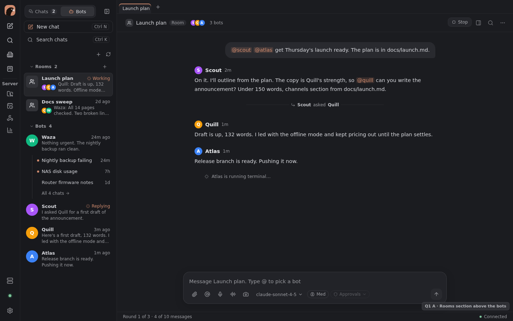
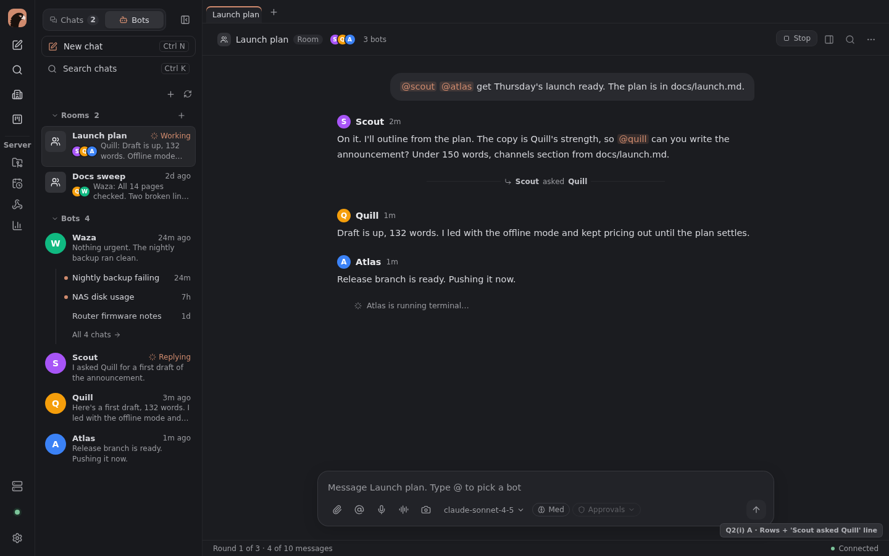
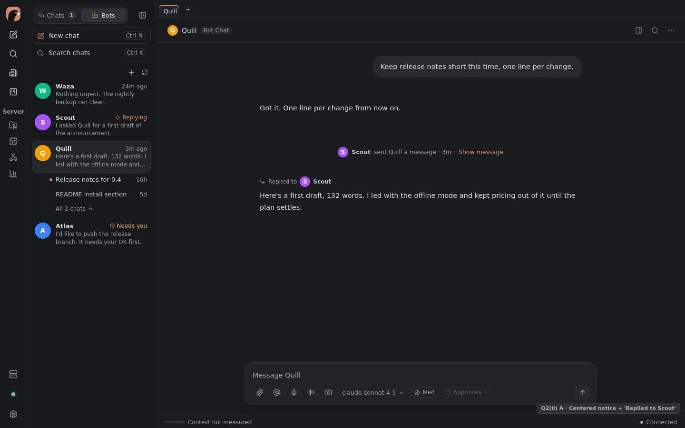
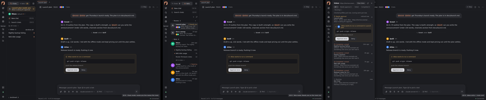

# Bot handoffs: rooms, bot-to-bot messages, and approvals that reach you

Status: proposed. Nothing in this document is built. The owner reviews it before implementation starts. Issue: #21.

The owner wants to see their bots hand work to each other and to know when a bot needs a human decision. Three parts make that up:

- Hermes Group Chat rooms of 2 to 6 bots, where one bot can bring in another.
- Direct messages from one bot to another, shown in both bots' Bot Chats.
- A room approval that reaches the owner like a chat's Approval (ADR 0173), and is answered from the inbox.

The facts below come from Hermes's source at `ae2a81ccc0` and from `docs/research/fleet-features-server-support.md`, section "Rooms where bots work together". No server ran for this document. The spike in section 6 checks the facts that the design depends on.

## 1. Hermes does most of the work already

**Rooms run on the owner's server with no setting.** The dashboard serves the `groups.*` methods on `/api/ws` and starts the room worker at boot. A room holds 2 to 6 bots with unique handles. A message from the owner with no mention goes to every bot. A bot that writes a peer's `@handle` gives that peer the next round. A discussion stops after 3 rounds or 10 messages by default.

**A room tells clients nothing on its own on the owner's server.** The client reads `groups.state` and then `groups.log` from its last `seq`. Hermes desktop reads every 2 seconds while a room is open. Newer Hermes sends a `groups.changed` event, but not when the dashboard forwards the call to a profile's gateway.

**A room approval lives only in `groups.state`.** It is in `driver_status.pending_actions`. It carries the member session's own approval prompt, with the choices cut to `once` and `deny`. The client answers it with `groups.approve`. Hermes answers 5119 when the approval is no longer pending.

**A message between two bots on one server needs no client.** Bot A calls the `message_agent` tool, and bot B's profile gateway delivers the message into B's Bot Chat. If B's gateway isn't running, Hermes refuses with `runtime_unavailable` and sends nothing. B's Bot Chat stores the message as a user row that starts with `Message from 🤖 Scout (@scout): `. That prefix is the only marker a client can see. A's Bot Chat stores the tool call, a delivery receipt, and later a `process_complete` row with B's answer. Highwing shows all of these rows raw today.

**A message to a bot on another connection needs the client as courier.** The client drains the sender's outbox with `bot_relay.outbox.drain`, delivers with `bot_relay.deliver`, and reports back with `bot_relay.reply`. Queued messages expire after 900 seconds.

**The client must not call `groups.capabilities` as a check.** On the legacy path, its first call writes `.room-link-grant-secret` into the Hermes home. A read of `groups.state` for a room id that doesn't exist answers 4114 (legacy) or 4001 (forwarded) when Hermes has rooms, and -32601 when it doesn't. That read changes nothing.

## 2. The design

Four models sketched the design independently in an architect arena (Opus, Fable, Sonnet, and Haiku), and a Fable judge scored them. All four reached the same shape. The design below takes the Fable candidate as its base and adds parts of the other three.

### One owner holds room state for each connection

`src/hermes/rooms/` exports `Rooms`, which each `Hermes` instance holds as `hermes.rooms`. `Rooms` is the only caller of `groups.*` and the only writer of room state. Its internals (`wire.ts`, `log.ts`, and `schedule.ts`) can't be imported from outside, and a test fails the build if a file tries.

Rooms live in the server's shared store, so `Rooms` reads them over whichever socket is open. A room never makes the app switch profile. A profile switch counts as a reconnect, and each log resumes from its cursor.

`Rooms` keeps four private pieces, and each piece has one writer:

- the room list,
- each room's status, from `groups.state`,
- each room's log, from `groups.log`,
- the owner's own lines and answers that are still in flight.

The screen is a pure merge of the four. An optimistic line never goes into the log. The line stops showing when the log carries its event.

### Reads run only while something needs them

Mounting `useRoom` or `useRoomList` is the lease that starts reads. One pure function, `nextReads`, decides every interval:

| What | Interval |
|---|---|
| A room on screen | 2 s, or 15 s once a `groups.changed` event has arrived |
| A room last seen working or waiting on the owner | 15 s, with no lease |
| The room list while Bots mode shows | 15 s |
| The room list otherwise | 60 s, and a moved `latest_seq` triggers a state read |
| Everything on a Background connection | 60 s, and it never writes (ADR 0125) |

Tests pass shorter intervals and a clock into `Rooms`, because the e2e harness can't fake timers in the app's frame.

### The log merges the same way every time

`mergeLog` sorts events by `seq` and ignores a `seq` it already has. Merging one page twice gives the same result as merging it once. The cursor only grows. If Hermes reports a `latest_seq` below the cursor, `Rooms` starts a new epoch and reads from 0. A read after a reconnect is the same read as any poll. So the screen matches `groups.log` after a reconnect by construction.

Every send carries a client `event_id`, and a retry reuses it. Hermes maps the id to its own, so a resend never posts twice.

### A room has its own view

`RoomPane` covers the chat area, as the Work page does. `ChatPane`, `Item`, and pane tabs don't change. `RoomPane` shows `RoomLine`, a union of six kinds: `said`, `handoff`, `notice`, `paused`, `working`, and `approval`.

A handoff line ("Scout asked Quill") is derived and never stored. A member's message that names a peer's `@handle` makes a handoff line when that peer speaks next in the thread or is working now. Where newer Hermes writes `room.routed` or `room.assignment` events, those events win.

Rooms as chats were rejected. That shape adds an author to `Item` and draws rooms in `ChatPane`, so every chat feature (edit, branch, queue, read marks, and tabs) needs a room exception.

### A room approval uses the chat's Approval card

`wire.ts` turns each pending action into `RoomApproval { key, member, item }`. The `item` is the same `ApprovalItem` that a chat's card takes, with the choices `once` and `deny` only. So the card can't offer a broader grant, and no grant confirmation appears. `ApprovalCard` gains one optional prop, `asker`, for its heading: "Atlas in Launch plan wants to run a command". Every guard from ADR 0173 stays: hidden characters written out, the arming delay, and the deliberate click.

`rooms.answer(key, "once" | "deny")` is the one answer path, for the room, the inbox, and a notification's Deny. It does these things:

- It answers only a key that is still pending. The key includes the execution generation and the request id.
- It joins a second click instead of sending twice.
- It refuses while offline and on a Background connection.
- It shows 5119 as "Hermes stopped waiting".

### "Needs you" has one source

A room needs the owner when its `pending_actions` list isn't empty. Hermes desktop's current room view uses the same rule. That one fact feeds five places: the inbox entry, the room row's mark, the Bots tab count, the needs-you line in Chats mode, and one desktop notification. None of the five quotes the command.

`InboxEntry` and `NoticeCard` become unions of `chat` and `room`. A room entry carries no fake profile or chat id, and the compiler finds every reader that has to narrow. On a Background connection a room approval shows as an entry that names the server. Opening the entry makes that server the composer target, as ADR 0125 does for a chat.

The app doesn't match `@user` in a bot's text. Nothing in Hermes's room prompt tells a bot to write it, so a text match would only raise false alarms.

### Bot-to-bot messages are a view of rows the Bot Chat already has

`botTalk(items, self, roster)` is a pure function that runs when a Bot Chat renders. It adds no `Item` kind and changes nothing in the transport. Highwing builds items from stored rows in two places, and saves items to disk, so a new item kind could come out differently on each path.

- In the receiving bot's chat, the prefixed row draws as a short notice from the sender. The receiving bot's next answer is marked "Replied to Scout".
- In the sending bot's chat, the `message_agent` call draws as "Asked Quill" with its delivery state, for example "Quill isn't running, so it wasn't sent". The answer comes from the `process_complete` row.
- A row that doesn't match the format exactly stays an ordinary row.

### Highwing doesn't carry messages between servers in this feature

As courier, Highwing would send on Background connections, which ADR 0125 forbids. Delivery would also work only while the app is open, and queued messages die after 900 seconds. Rooms that mix servers use Hermes's own RoomLink, so they don't need the courier. ADR 0206 records the decision and what would reopen it.

### Hermes's refusals reach the owner unchanged

The app doesn't check the 2 to 6 rule itself. The New room dialog says "2 to 6 bots" and shows Hermes's own refusal. On the legacy path Hermes answers 5111 with "members must contain between 2 and 6 entries". On the forwarded path it answers 4001 with the same sentence in `data.detail`, so `RpcError` gains a `data` field.

### The capability check reads, and the app can't call `groups.capabilities`

The capability `rooms` checks with `groups.state {room_id: "hermes-chat-probe"}`. `groups.capabilities` stays out of `APP_METHODS`, so the type checker refuses any call to it.

### The word "handoff" moves

GLOSSARY gains **Room** and **Handoff**. The **Dispatched work** entry lists "handoff" under _Avoid_, and `src/hermes/dispatched.ts` exports a type named `Handoff`. So the type becomes `DispatchStanding`, and the _Avoid_ line changes.

## 3. The prototypes

These pages are throwaway. They reuse the real app's markup and CSS, captured from the e2e harness. The recommended option for each question comes first.

**Where rooms sit.** Recommended: a Rooms section above the bots in Bots mode (A). A third tab (B) barely fits in the 272 px panel. Rooms mixed with the bots (C) push the bot's own chats down.

[B: a third tab](bot-handoffs/q1-b-tab.png) · [C: rooms mixed with bots](bot-handoffs/q1-c-mixed.png)

**A handoff in a room.** Recommended: each bot's face and name, with a muted "Scout asked Quill" line (A). A chip with the answer indented under it (B) indents further with every handoff.

[B: a chip and an indented answer](bot-handoffs/q2-i-b-chip.png)

**A message from another bot in a Bot Chat.** Recommended: a small centered notice, with "Replied to Scout" above the answer (A). A bubble from the other bot (B) puts a second speaker in a chat with one bot.

[B: a bubble from the other bot](bot-handoffs/q2-ii-b-bubble.png)

**A room approval.** Recommended: the inbox entry with the room's card, Needs you on the room row, and a "Launch plan needs you" line in Chats mode (B). Without the line (A), Chats mode shows only the Bots tab count. Marking the bot's own row (C) shows one approval in two places and cuts the bot's name short.

[A: inbox and room row only](bot-handoffs/q3-a-inbox-bell.png) · [C: marked on the bot's row](bot-handoffs/q3-c-bot-centric.png)

The prototype's room composer keeps the model picker and the Approvals pill. The real composer drops both, because each bot runs on its own model.

## 4. Delivery in small PRs

Each PR passes `npm run check`. Each PR that changes the UI attaches screenshots. Before each ADR, `scripts/check-adrs.mjs` confirms the next free number. The highest number in use is 0203.

| # | PR | After | Check |
|---|---|---|---|
| 0 | Spike, not a PR. Run the checks in section 6 on a throwaway Hermes at the owner's commit (`bf0203a`) and at the newest commit, with two bot profiles. | none | An evidence file that answers each check |
| 1 | Words. GLOSSARY entries for Room and Handoff, the `Handoff` to `DispatchStanding` rename, and ADR 0204 for rooms. | none | `check-adrs`, the build, and the existing tests |
| 2 | Room member sessions stay out of the lists. `Source` gains `botRoom`, and `ChatKind` gains `roomMember`. | none | `chatKind.test.ts`; an inbox test that a waiting `Group: x` session makes no entry; an e2e check that the session isn't listed |
| 3 | Hermes says whether it has rooms. `FakeRooms` with every handler, the legacy, forwarded, and absent paths, and test controls. Also the verbs, the capability, `RpcError.data`, and the compatibility section. An unknown `groups.*` call in FakeHermes answers -32601 instead of hanging. | 1 | `capabilities.test.ts` for 4114, 4001, and -32601; `sessionProtocol.test.ts`; a test that no code sends `groups.capabilities` |
| 4 | The log core: `wire.ts`, `log.ts`, and `schedule.ts`. | 3 | Unit tables. Merging twice equals merging once. An epoch resets. A handoff appears only when the peer then speaks. `room.assignment` wins. `nextReads` gives the right interval in each state, with and without push. |
| 5 | The owner: `Rooms`, its hooks, the transport wiring, and the `groups.changed` branch. | 4 | `rooms.test.ts` against FakeHermes with an injected clock. No reads with no lease and no live room. A profile switch keeps the transcript. A send across a reconnect is one log event. A Background connection never writes. |
| 6 | Rooms on screen: the section in Bots mode, `RoomPane`, the New room dialog, and the interface text. | 5 | `rooms.e2e.tsx`. Create rooms of 2 and 6 bots. Hermes's own text refuses 1 and 7 on both paths. The handoff line shows. After a dropped socket, the screen equals `groups.log` from 0. |
| 7 | `InboxEntry` and `NoticeCard` become unions, with no change in behavior. | none | The type checker and the existing inbox and notification tests, unchanged |
| 8 | Room approvals and needs-you: the inbox entry, `ApprovalCard.asker`, the notification, the Bots tab count, the needs-you line, and ADR 0205, which amends ADR 0173. | 6, 7 | `room-approval.e2e.tsx`. The inbox card answers once, and FakeHermes records one `groups.approve`. The entry clears. An approval answered elsewhere ends the card (5119). A double click sends once. A Background connection shows no card. |
| 9 | Bot-to-bot in both Bot Chats: `botTalk.ts`, `BotTalkRow`, and ADR 0206, which amends ADR 0066 and records the courier decision. | 0 | `botTalk.test.ts` on rows copied from the spike's server; `bot-to-bot.e2e.tsx` opens Scout, then Quill, and takes a screenshot of each |
| 10 | Proof in the real app: a verify-hermes-chat recipe, `features/rooms.md`, and bridge controls under `POST /__rooms/`. | 6, 8, 9 | A verify-hermes-chat run with a screenshot of every done check; `selftest` passes |

PRs 3, 4, 5, 6, 8, and 10 run in that order. PRs 1, 2, 7, and 9 can be built alongside them.

## 5. Done means

- The owner can create a room of 2 to 6 bots. Hermes refuses 1 or 7 bots, and the owner sees Hermes's own error.
- A message to one bot that mentions another hands off. After a reconnect, the room's log read back with `groups.log` matches the screen.
- A message from one bot to another on the same server shows in both bots' Bot Chats.
- A room approval shows in the inbox like other approvals. Answering it calls `groups.approve` and clears it.
- `npm run check` passes.

## 6. The spike settles six facts first

Each fact changes a named PR if the answer differs from what this design assumes.

1. From the sockets of two different profiles, does `groups.list` return the same rooms, on the legacy path and on the forwarded path? If not, `Rooms` gains a profile argument inside the module (PR 5).
2. Does `session.active_list` list `Group: <room_id>` sessions, and with which source? The answer decides whether the inbox shows a room approval twice today (PR 2).
3. Which fields does a pending room approval carry? If it lacks the command and its description, ADR 0173 forbids approving from the inbox, and the inbox entry only opens the room (PR 8).
4. Does a `message.user` event carry the `event_id` that `groups.send` took? If not, the app matches an optimistic line by its text and thread (PR 5).
5. Does Highwing holding bot B's Bot Chat make a `message_agent` delivery to B fail with `runtime_coordination_required`? If so, the sending bot's view says so (PR 9).
6. What exactly does the owner's server answer for 1 and 7 members? Are log `seq` values contiguous (PR 4 and PR 6)?

## 7. Decisions the owner makes before PR 1

1. **Courier between servers.** This design leaves out the `bot_relay` courier. Building it means an ADR that amends ADR 0125.
2. **Needs you.** A room needs the owner when it has an approval waiting. The app doesn't match `@user` in a bot's text.
3. **The spike's server.** The spike creates rooms and sends messages. It runs on a throwaway Hermes, never on the owner's server.
4. **The prototype picks and the rename.** Section 3 has the picks. The `Handoff` type in `src/hermes/dispatched.ts` becomes `DispatchStanding`.
